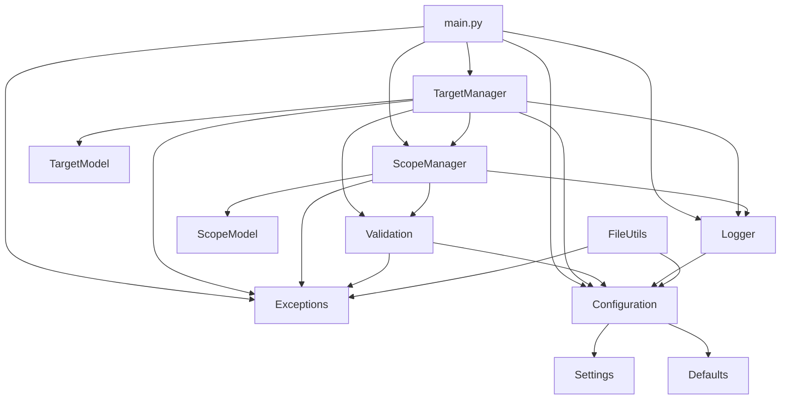

# XENON — Phase 01
# Foundation & Target Management

## 1. Phase Overview

Phase 01 establishes the foundational layer of the XENON web security assessment platform.

The purpose of this phase is to create a stable, modular and security-focused foundation on which all future bug-bounty and web-security assessment phases will be built.

Phase 01 does not perform vulnerability scanning or vulnerability detection.

It is responsible for:

- Project configuration
- Target management
- Scope management
- Target validation
- Scope enforcement
- Common data models
- Logging
- Common exception handling
- File/output utilities
- CLI entry point
- Foundation-level testing

All future security assessment modules must be able to use the interfaces and contracts established in this phase.

---

# 2. Purpose

The primary purpose of Phase 01 is to ensure that XENON knows:

1. What target is being assessed.
2. Whether the target is valid.
3. What is allowed to be tested.
4. What is not allowed to be tested.
5. How target and scope information is represented.
6. How configuration is loaded.
7. How application events and errors are logged.
8. How common errors are handled.
9. Where generated output can be stored.
10. How the foundation layer can be tested.

The foundation must be designed so that future phases can consume it without directly modifying its internal implementation.

---

# 3. Scope of Phase 01

## Included

Phase 01 includes:

- Target URL validation
- Target creation and management
- Scope definition
- In-scope validation
- Out-of-scope rejection
- Subdomain scope handling
- Configuration management
- Application logging
- Common exception hierarchy
- Target and scope data models
- File utility functions
- CLI initialization
- Foundation tests
- Phase documentation

## Excluded

The following are explicitly outside the responsibility of Phase 01:

- Subdomain enumeration
- DNS enumeration
- Port scanning
- Technology detection
- Directory discovery
- Endpoint discovery
- Parameter discovery
- Authentication testing
- Authorization testing
- IDOR detection
- SQL injection detection
- XSS detection
- SSRF detection
- Command injection detection
- Vulnerability detector execution
- AI-based vulnerability decision making
- Exploit generation
- Payload generation
- HTTP fuzzing

These capabilities belong to later phases.

---

# 4. Architecture

Phase 01 follows a modular architecture.

---

# 5. Folder Structure

phase01/
│
├── README.md
│
├── main.py
│
├── config/
│   ├── settings.py
│   └── defaults.py
│
├── core/
│   ├── target_manager.py
│   ├── scope_manager.py
│   ├── logger.py
│   └── exceptions.py
│
├── models/
│   ├── target.py
│   └── scope.py
│
├── utils/
│   ├── file_utils.py
│   └── validation.py
│
├── output/
│   └── .gitkeep
│
└── tests/
    ├── test_file_utils.py
    ├── test_logger_security.py
    ├── test_scope_manager.py
    ├── test_target_manager.py
    └── test_validation.py

---

# 6. File Responsibilities

## 6.1 main.py

main.py is the Phase 01 entry point.

Responsibilities:

Initialize XENON Phase 01.
Load configuration.
Initialize logging.
Accept or load target information.
Validate target.
Load scope information.
Validate scope.
Initialize required managers.
Display basic initialization status.
Handle expected application errors gracefully.

main.py must not contain target-validation or scope-management business logic directly.

Business logic belongs to the appropriate core modules.

## 6.2 config/settings.py

Responsible for application-level configuration access.

Responsibilities may include:

Application configuration
Output directory configuration
Logging configuration
Environment-related configuration
Runtime settings

Configuration should be centralized rather than duplicated across modules.

## 6.3 config/defaults.py

Contains default configuration values.

Examples:

Default output directory
Default logging level
Default application name
Default target status
Other Phase 01 defaults

Defaults must be kept separate from runtime configuration.

## 6.4 core/target_manager.py

Responsible for target lifecycle management.

Responsibilities:

Create target representation.
Validate target input through validation utilities.
Store current target information.
Retrieve current target.
Update target when explicitly requested.
Ensure target data is internally consistent.
Coordinate with scope validation.

The Target Manager must not implement vulnerability detection logic.

## 6.5 core/scope_manager.py

Responsible for scope enforcement.

Responsibilities:

Load scope configuration.
Store in-scope entries.
Store out-of-scope entries.
Determine whether a target/resource is in scope.
Reject explicitly out-of-scope resources.
Support domain/subdomain scope rules.
Provide a simple interface for future modules.

Critical security requirement:

No future XENON module should be allowed to perform an assessment request against a resource that the Scope Manager determines to be out of scope.

Example:

IN SCOPE

example.com
api.example.com
*.example.com

OUT OF SCOPE

payments.example.com
third-party.example.net

The exact scope rules must be deterministic and testable.

## 6.6 core/logger.py

Responsible for centralized application logging.

The logger should support at minimum:

INFO
WARNING
ERROR
DEBUG

Example:

[INFO] XENON started
[INFO] Target loaded
[INFO] Scope loaded
[INFO] Target validated
[ERROR] Invalid target

Logging should be centralized so that future phases can reuse the same logging mechanism.

Sensitive information such as credentials, authentication tokens, cookies or secrets must not be logged.

## 6.7 core/exceptions.py

Contains common Phase 01 exceptions.

At minimum, the architecture should support errors for:

Invalid target
Invalid scope
Out-of-scope target/resource
Configuration errors
File/output errors

Exceptions should be meaningful and allow main.py and future modules to distinguish expected application failures from unexpected failures.

## 6.8 models/target.py

Defines the Target data model.

The model should represent information such as:

{
  "target": "https://authorized-target.example",
  "created_at": "...",
  "status": "active"
}

The implementation may use an appropriate Python data-model approach.

The model should remain focused on representing target data.

Business logic should remain in the appropriate manager/utility modules.

## 6.9 models/scope.py

Defines the Scope data model.

The model should represent:

In-scope resources
Out-of-scope resources
Scope rules
Scope configuration required by the Scope Manager

Example conceptual structure:

Scope
│
├── in_scope
│   ├── example.com
│   ├── api.example.com
│   └── *.example.com
│
└── out_of_scope
    ├── payments.example.com
    └── third-party.example.net

## 6.10 utils/file_utils.py

Provides reusable file-related utilities.

Responsibilities:

Create required directories.
Verify output paths.
Read supported Phase 01 configuration/data files if required.
Write structured output where required.
Handle file-related errors safely.

File operations should not be duplicated across core modules.

## 6.11 utils/validation.py

Contains reusable validation functions.

Responsibilities include:

Target validation

Validate:

Target is not empty.
Target has valid URL structure.
Supported URL scheme.
Valid hostname.
Invalid/malformed target rejection.

Examples:

https://example.com        → VALID
https://api.example.com   → VALID

""                         → INVALID
example.com                → INVALID
invalid://target           → INVALID

Scope validation

Validate:

Scope entries are syntactically valid.
Empty/invalid entries are rejected.
Scope configuration is internally consistent.

Validation utilities should return clear results or raise defined Phase 01 exceptions.

----

# 7. Target Management

A target represents the authorized web resource that XENON is expected to assess.

Conceptually:

{
  "target": "https://authorized-target.example",
  "created_at": "ISO-8601 timestamp",
  "status": "active"
}

If scope information is associated directly with the target object, it must use the defined Scope model rather than an arbitrary dictionary structure.

Target status should be explicit.

Example:

active
inactive

The exact status values must be centralized rather than scattered as hard-coded strings.

----

# 8. Scope Management

Scope is a security boundary.

The Scope Manager must answer a fundamental question:

Is this resource allowed to be assessed?

Possible result:

IN_SCOPE
OUT_OF_SCOPE

The decision must be deterministic.

Example:

Configured scope:

IN:
example.com
*.example.com

OUT:
payments.example.com

Expected behavior:

example.com                 → IN SCOPE
api.example.com             → IN SCOPE
test.example.com            → IN SCOPE

payments.example.com        → OUT OF SCOPE
third-party.example.net     → OUT OF SCOPE

Explicit out-of-scope rules must take precedence over broader in-scope rules.

-----

# 9. Scope Enforcement Requirement

Scope enforcement is a mandatory security control.

Future modules must be able to call the Scope Manager before performing an assessment action.

Conceptually:

Future Module
      │
      ▼
Scope Manager
      │
      ├── IN SCOPE ──────► Continue
      │
      └── OUT OF SCOPE ──► Reject

The foundation must make it difficult for future modules to accidentally bypass scope validation.

-----

# 10. Input

Phase 01 may receive target information through the CLI or another explicitly defined input mechanism.

Minimum target input:

https://authorized-target.example

Scope input should define authorized and unauthorized resources.

Conceptual example:

{
  "in_scope": [
    "example.com",
    "*.example.com"
  ],
  "out_of_scope": [
    "payments.example.com",
    "third-party.example.net"
  ]
}

Input must be validated before being accepted by the system.

-----

# 11. Output

Phase 01 does not generate vulnerability findings.

Its primary output is validated foundation state.

Conceptually:

XENON initialized successfully

Target:
https://authorized-target.example

Target Status:
ACTIVE

Scope:
VALID

Scope Enforcement:
ENABLED

Any structured state/output required by later phases must use stable schemas.

-----

# 12. Data Contracts

Phase 01 must establish stable data contracts for:

Target
Scope
Validation result
Application errors

Future phases should consume these contracts instead of creating incompatible representations.

Target Contract

Conceptually:

{
  "target": "https://authorized-target.example",
  "created_at": "2026-01-01T00:00:00Z",
  "status": "active"
}
Scope Contract

Conceptually:

{
  "in_scope": [
    "example.com",
    "*.example.com"
  ],
  "out_of_scope": [
    "payments.example.com"
  ]
}

The final implementation must keep field names consistent throughout Phase 01.

-----

# 13. Dependencies

Phase 01 should minimize external dependencies.

Prefer Python standard-library functionality wherever practical.

Potential standard-library modules include:

dataclasses
datetime
pathlib
json
logging
urllib.parse
argparse
re
typing

External dependencies must not be introduced without a clear requirement.

-----

# 14. Integration

Phase 01 is the foundation for future XENON phases.

Future modules should be able to obtain:

Target
Scope
Configuration
Logger
Common Exceptions
File Utilities
Validation

without depending on the internal implementation of Phase 01.

Conceptual future integration:

Phase 01
   │
   ├── Target
   ├── Scope
   ├── Configuration
   ├── Logging
   └── Validation
          │
          ▼
     Future Phases
          │
          ├── Recon
          ├── Endpoint Discovery
          ├── Parameter Discovery
          ├── Vulnerability Detection
          └── Reporting

-----

# 15. Error Handling

Expected errors must be handled gracefully.

Examples:

Invalid target
Invalid URL
Invalid scope
Out-of-scope resource
Invalid configuration
Missing output directory
File operation failure

Expected errors should:

Produce a meaningful log message.
Raise/use the appropriate custom exception where applicable.
Avoid exposing sensitive information.
Avoid crashing with an unnecessary Python traceback for normal user errors.

Unexpected programming errors may still surface during development/testing and should be logged appropriately.

-----

# 16. Testing Strategy

Phase 01 must include automated tests.

Testing must verify both normal behavior and security boundaries.

Target Manager Tests

At minimum:

Valid target
Empty target
Invalid URL
Malformed URL
Target creation
Target retrieval
Target status
Scope Manager Tests

At minimum:

Exact domain in scope
Exact subdomain in scope
Wildcard subdomain
Explicit out-of-scope domain
Out-of-scope precedence
Unknown domain
Invalid scope entry
Validation Tests

At minimum:

Valid HTTPS URL
Valid HTTP URL if supported
Invalid scheme
Missing hostname
Empty input
Malformed URL
Valid domain
Invalid domain/scope entry

-----

# 17. Security Considerations

Phase 01 is security-critical because it establishes the boundary for all future assessment activity.

Mandatory considerations:

## 17.1 Scope Safety

Out-of-scope resources must never be treated as valid assessment targets.

## 17.2 Explicit Scope Precedence

An explicit out-of-scope rule must override a broad wildcard rule.

## 17.3 Input Validation

Target and scope input must be validated before use.

## 17.4 Sensitive Data

Do not log:

Passwords
API keys
Access tokens
Session cookies
Authorization headers
Secrets

## 17.5 Logging Security Notes

The `SensitiveDataFilter` implements the following security mechanisms:

- **Exception argument redaction:** Sensitive patterns appearing in exception string arguments are redacted before exception reconstruction, reducing the risk of secrets leaking through formatted traceback output.
- **Compatible exception reconstruction:** When an exception type supports reconstruction via `exc_type(*new_args)` with the redacted arguments, the original traceback reference is preserved.
- **Fail-closed behavior:** If exception reconstruction fails (for example, if a custom exception requires constructor parameters beyond `*args`), `record.exc_info` is set to `None`. This prevents exposure through a failed reconstruction, but results in losing traceback information for that log record.
- **stack_info filtering:** The `stack_info` field of log records is also filtered, reducing the risk of secrets appearing in stack traces.
- **Compatibility limitation:** Not every possible custom exception is supported. Exceptions requiring positional or keyword arguments beyond standard `*args` will trigger the fail-closed behavior.

## 17.6 Path Safety

File utilities must avoid unsafe/unintended filesystem paths.

## 17.7 Deterministic Decisions

Scope decisions must be deterministic and reproducible.

------

# 18. Implementation Constraints

The following constraints must be followed while implementing Phase 01.

Do not change the locked folder structure.
Do not add unrelated features.
Do not implement future-phase vulnerability detection.
Do not introduce an AI layer in Phase 01.
Do not introduce unnecessary external dependencies.
Do not duplicate business logic across files.
Do not bypass Scope Manager checks.
Do not hard-code configuration values throughout the codebase.
Keep modules focused on their defined responsibilities.
Write tests for implemented behavior.
Follow the data contracts defined in this README.
Update this README only when an approved architectural change occurs.

-----

# 19. Testing Environment

Phase 01 testing should be performed using safe, controlled inputs.

No real-world target should be accessed merely for testing Phase 01.

Recommended examples:

https://example.com
https://api.example.com

For scope logic, use synthetic/test domains and controlled test cases.

-----

# 20. Implementation Status

Current status:
Architecture: LOCKED
README Specification: v1.0 — documentation re-audit passed
Implementation: COMPLETED
Testing: PASS — 124 tests, 0 failures, 0 errors
Code Review: COMPLETED
Regression Testing: PASS
Final User Approval: PENDING USER CONFIRMATION
Overall Phase 01 Closure: READY FOR FINAL APPROVAL

----

# 21. Known Limitations

Phase 01 intentionally has limited functionality.

It does not:

Discover targets automatically.
Enumerate subdomains.
Scan ports.
Discover endpoints.
Discover parameters.
Detect vulnerabilities.
Execute security payloads.
Analyze HTTP responses for vulnerabilities.
Make AI-based security decisions.

These capabilities will be implemented in later phases.

----

# 22. Future Extension

Future phases may extend the foundation with:

Reconnaissance modules
DNS intelligence
Subdomain discovery
HTTP client infrastructure
Endpoint discovery
Parameter discovery
Technology detection
Vulnerability detectors
Response analysis
Evidence collection
Finding management
Reporting
AI-driven security reasoning
Tool orchestration

These extensions must consume the Phase 01 contracts rather than bypassing them.

----

# 23. Definition of Done

Phase 01 is considered complete only when:

- [x] Locked folder structure exists.
- [x] README specification exists.
- [x] Configuration system works.
- [x] Target model works.
- [x] Target Manager works.
- [x] Scope model works.
- [x] Scope Manager works.
- [x] Target validation works.
- [x] Scope validation works.
- [x] Out-of-scope resources are rejected.
- [x] Explicit out-of-scope rules take precedence.
- [x] Centralized logging works.
- [x] Common exceptions are implemented.
- [x] File utilities work.
- [x] main.py initializes Phase 01 successfully.
- [x] Automated tests are implemented.
- [x] Target tests pass.
- [x] Scope tests pass.
- [x] Validation tests pass.
- [x] No known critical foundation/security issue remains.
- [x] Code review is completed.
- [x] Regression testing is completed.
- [ ] User gives final approval.

-----

# 24. Change Log

v1.0
Phase 01 architecture defined.
Folder structure locked.
Module responsibilities defined.
Target management specification defined.
Scope management specification defined.
Validation requirements defined.
Logging requirements defined.
Testing strategy defined.
Security requirements defined.
Definition of Done defined.
